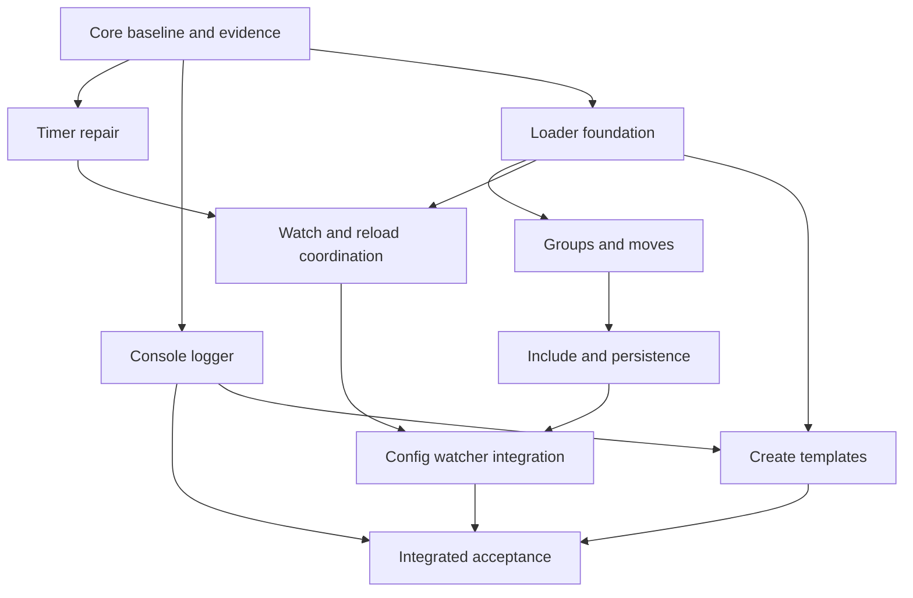

# Cordis core and satellite completion plan

Date: 2026-11-02. Status: **proposed work packages for review and scheduling**.
The user requested planning across the core and every satellite. This document
does not mark future APIs, dependencies, compatibility departures, or releases
as approved or implemented. Calendar dates and execution owners are unassigned.

## Objective and meaning of completion

Finish the evidenced defects in the delivered Rust framework, then deliver
useful Rust equivalents for all seven satellites in the pinned upstream.
For each upstream behavior, record one of: implemented and tested; explicit
Rust equivalent and tested; deliberately unsupported with a reviewed reason;
or a named remaining work package. A small initial slice is not full satellite
completion. Unsupported behavior is never counted as tested parity.

The scope is the repository at Rust revision `808c9f5` and TypeScript revision
`35fdc969e4b6c48c48ed44717c7a018324e4dd88`. The latter was verified locally
with no tracked changes on the planning date. Keep the pin fixed throughout
this program; upgrading upstream requires a separate delta inventory.
The independent Rust port remains engineering evidence, not a specification.

## Reading order

| Document | Purpose | Work packages |
|---|---|---|
| [Core and evidence](core.md) | Baseline, compatibility audit, narrowly justified integration fixes | B0–B2 |
| [Timer repair](timer.md) | Admission, deadlines, authority, cancellation, terminal cleanup, callback safety | T0–T5 |
| [Console logger](logger.md) | Rendering and writer/exporter adapter over core logging | C0–C3 |
| [Loader](loader.md) | Registered factories, entry lifecycle, configuration, moves, isolation | L0–L5 |
| [Group](group.md) | Structural groups owned by loader; packaging decision | G0–G1 |
| [Include](include.md) | Config sources, patches, provenance, reconciliation and persistence | I0–I4 |
| [HMR](hmr.md) | Scoped watchers, reload coordination and honest Rust code-reload boundaries | H0–H3 |
| [Create](create.md) | Reproducible Cargo application scaffolding | S0–S2 |
| [Acceptance](acceptance.md) | Shared delivery gates and final integration/release assessment | R0–R1 |
| [Scheduling](schedule.md) | Dependencies, review boundaries, scheduling worksheet | All |
| [Source inventory](source-inventory.md) | Pinned satellite test declaration locations and package coverage | Inputs to every gate |

These are portfolio-level implementation plans: exact work products, file
boundaries, behavioral oracles and dependencies are specified. Before executing
a new public API, its first work package produces and reviews exact signatures
and a short test-first coding plan. Freezing every loader/HMR signature now
would hide unresolved architectural choices. Near-term timer regressions are
more concrete because the public surface already exists.

## Current baseline

| Area | Evidence and qualification |
|---|---|
| Core | M0–M6 delivered; 144 named TS declarations accounted for in the historical case checklist, plus type checks. This is source mapping, not execution of every upstream variant. |
| Lifecycle hardening | Six paired scenarios / 73 observations recorded; no additional differential coverage is claimed by this plan. |
| GitHub consumers | Digest, collector and signed loopback journal delivered; 12 application tests on Unix. Preserve their bounded scope. |
| Timer | Implemented with 15 tests, example and bilingual docs. Source inspection exposes contract gaps; repair and acceptance remain open. |
| Other satellites | No Rust implementation in the workspace. Upstream group is only a re-export of loader's Group. |
| Fresh checks on 2026-11-02 | Workspace tests passed; five documentation regressions passed; eight unique guide/API examples and the external quick start passed on stable 1.97.1 and Rust 1.85.0. Full lint/MSRV workspace/differential matrices were not rerun for the initial review. |

The baseline is historical evidence attached to a revision, not a continuing
claim that the tree is green after future edits. B0 records a fresh executable
baseline before the first production change.

## Recommended approach and alternatives

**Recommended: repair foundations, then vertical satellite slices.** Close
timer correctness gaps, ship the console adapter, grow loader/group, then
include and HMR, and finally scaffold the accepted application shape. Each
slice carries tests, documentation and a reviewable commit.

An application-first path could stop after logger and minimal loader, but
would leave substantial include/HMR behavior outside the requested program.
A package-for-package translation would reproduce JS-only mechanisms, add
empty facades and encourage premature dependency choices. The recommended
path covers every package while allowing documented Rust representations.

## Global constraints

- Rust edition 2024; resolver 3; minimum Rust 1.85, tested with 1.85.0.
- MIT; version 0.0.0 and publish=false until a separate release decision.
- Explicit local Tokio/LocalSet hosting; preserve non-Send resources.
- TypeScript at the pinned revision defines semantics.
- Keep core production dependencies minimal; time, serialization, terminal,
  filesystem and watcher dependencies belong to the satellite using them.
- No public abstraction without a demonstrated caller; use existing core
  effects, plugins, service keys, exporters, validation and errors.
- Do not change core Effect/Fiber Drop semantics to repair timer wrappers.
- Preserve original errors, committed provider retention, Pending/readiness
  distinctions, explicit Failed recovery and joined cleanup.
- Update paired English/Vietnamese user docs for shipped public changes.
- Commit each verified slice on its execution branch; do not push automatically
  or add Co-authored-by trailers.

## Decision register

Recommendations below are proposals, with a concrete gate that must resolve
them. A gate produces a decision in docs/decision.md, signatures, rejected
alternatives and acceptance cases before dependent production work starts.

| Gate | Recommendation | Alternative and consequence |
|---|---|---|
| T0: zero and deadline policy | Pin deadlines on admission; normalize repeating zero to an explicitly documented minimum tick, preserving asynchronous behavior | Reject zero explicitly as a Rust deviation; never accept then panic in a background task |
| T0/B2: timer authority | Demonstrate required callback authority and reuse a scoped core mechanism; expose the smallest new bridge only if needed | Document restricted callbacks, but this changes upstream semantics and must be approved explicitly |
| C0: console policy | Owned synchronous Write adapter, explicit color/timestamp configuration, stdout default matching Node | stderr routing or async buffering changes behavior and adds testing/backpressure requirements |
| L0: loading model | Registry of linked Rust plugin factories, typed adapters, in-memory entry model | Native dynamic libraries need an ABI/lifetime design; not an interchangeable implementation detail |
| L0/L4: configuration | Programmatic typed input first; JSON at a satellite boundary; explicit typed evaluation callbacks | JavaScript eval/automatic schema discovery require a separate runtime and compatibility project |
| G0: packaging | Loader owns Group; no new crate unless import ergonomics justify a thin facade | A facade may re-export only; it must not own a second lifecycle implementation |
| I0: file formats | JSON first; YAML only after a parser/source-location/round-trip capability check | Read-only or canonical-write YAML is a documented partial feature, not lossless YAML compatibility |
| H0: reload meaning | Config reload plus explicit replacement of already-linked factory revisions; source change reports restart-required when replacement is unavailable | In-process arbitrary Rust binary replacement is separate research with no delivery promise here |
| S0: templates | Local/bundled template first, explicit local dependencies while unpublished | Remote template acquisition adds transport, integrity, archive and cache contracts |
| R1: distribution | Prepare release evidence and a packaging proposal | Publishing, stable APIs, platform expansion and live integrations require their own decision |

## Order and dependency map

The preferred delivery order remains timer, logger, loader. Logger does not
technically depend on timer, and loader does not automatically depend on either.
Include works without HMR; their integration is a later slice, avoiding a
dependency cycle. See the scheduling document for the finer work-package graph.

## Scope boundaries

All seven satellites have a workstream below; none is silently dropped.
Package completion means completion of its approved Rust scope plus an
exhaustive disposition of the pinned source cases. It does not imply JS Proxy,
browser console inspection, npm/Yarn installation, JS module cache mutation,
JavaScript expression execution, or native binary hot swapping.

The program preserves existing GitHub consumers as integration tests. Public
ingress, real webhook delivery, notifications, new external-service clients,
benchmarks, Send/Sync redesign and executor independence are separate projects.
If a use case proves one is necessary, add a named work package with its own
scope and cost rather than hiding it inside a satellite task.
